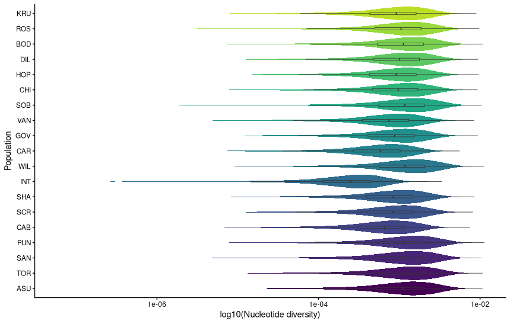

# Population Genomics notebook

**Course:** Intro to Ecological Genomics - Fall 2026

**Name:** Meron Abraham

**Date:** 10/22/2026

------------------------------------------------------------------------

## Genetic Diversity

-   Copying files with Tajima's D results
-   Visualising results

### Working directory

`/gpfs1/home/m/a/mabraha3/projects/eco_genomics_2026/population_genomics`

### Input files

`/gpfs1/home/m/a/mabraha3/projects/eco_genomics_2026/population_genomics/mydata`

### Output files

`/gpfs1/home/m/a/mabraha3/projects/eco_genomics_2026/population_genomics/pop_gen_notebook_10_22.md`

### Scripts

`/gpfs1/home/m/a/mabraha3/projects/eco_genomics_2026/population_genomics/myscripts/genetic_diversity.r`

### Code

`data_dir=/users/m/a/mabraha3/projects/eco_genomics_2026/population_genomics/mydata VCF=Lottia_gigantea_flt3_sub0.01.vcf.gz`

### Programs/dependencies

`R version 4.5.1` `RStudio`

### Graphs/images

### Tables

| Col1 | Col2 | Col3 | Col4 | Col5 |
|------|------|------|------|------|
|      |      |      |      |      |
|      |      |      |      |      |
|      |      |      |      |      |

#### Notes/observations

Observations and interpretations go here

### Next steps
