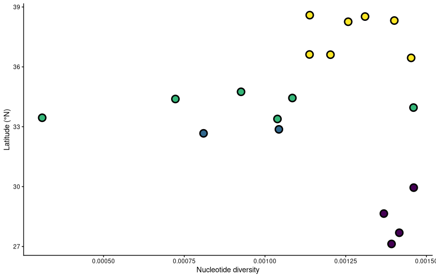
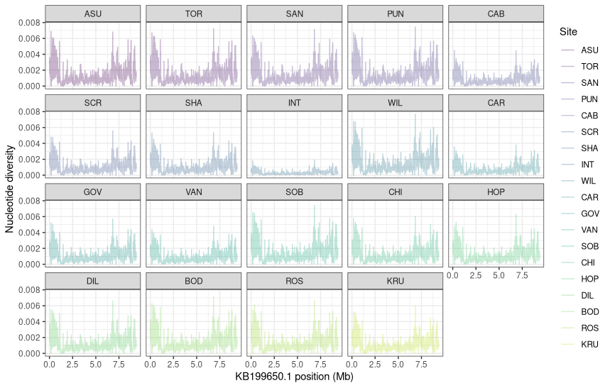
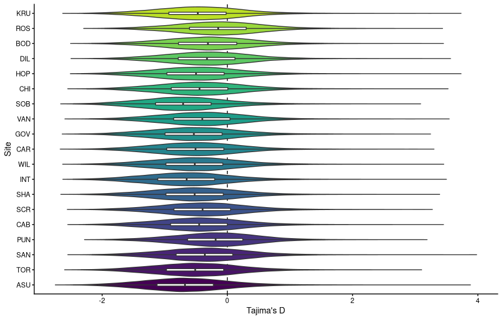
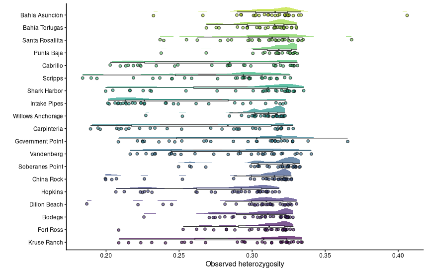
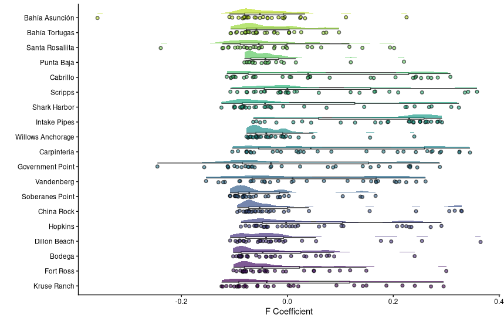

# Population Genomics notebook

**Course:** Intro to Ecological Genomics - Fall 2026

**Name:** Meron Abraham

**Date:** 10/27/2026

------------------------------------------------------------------------

## Selective signature

-   Copying and running commands in the VACC
    -   Tajima's D
    -   Fst
-   Plotting data in R

### Working directory

`/gpfs1/home/m/a/mabraha3/projects/eco_genomics_2026/population_genomics`

### Input files

`none`

### Output files

`/gpfs1/home/m/a/mabraha3/projects/eco_genomics_2026/population_genomics/myscripts/selective_signatures.R`

Scripts

`none`

### Code

`data_dir=/users/m/a/mabraha3/projects/eco_genomics_2026/population_genomics/mydata VCF=Lottia_gigantea_flt3_sub0.01.vcf.gz`

### Programs/dependencies

`R version 4.5.1` `RStudio`

### Graphs/images

Nucleotide diversity vs. latitude

Scan plot for each population

Tajima's D for each population

### Tables

| Col1 | Col2 | Col3 | Col4 | Col5 |
|------|------|------|------|------|
|      |      |      |      |      |
|      |      |      |      |      |
|      |      |      |      |      |

#### Notes/observations

Possibly increased rare alleles in newer northern and southern populations according to the pi latitude plot

### Next steps
