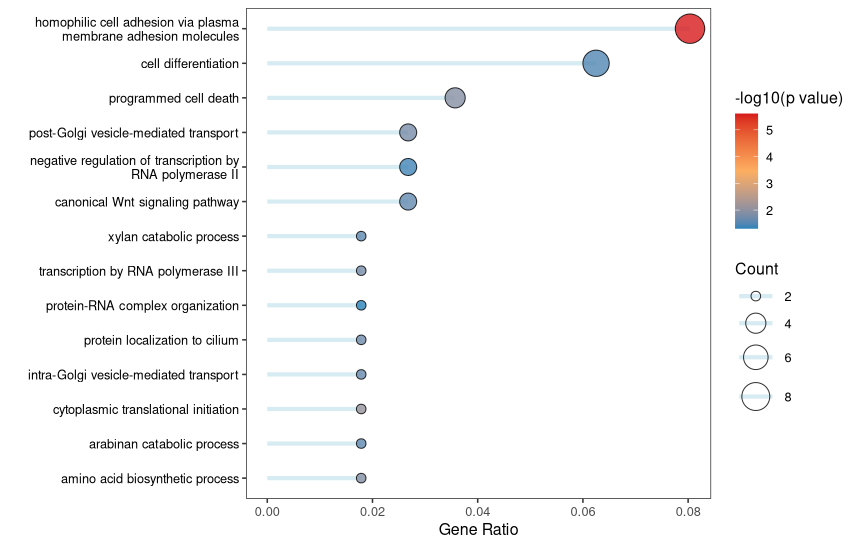
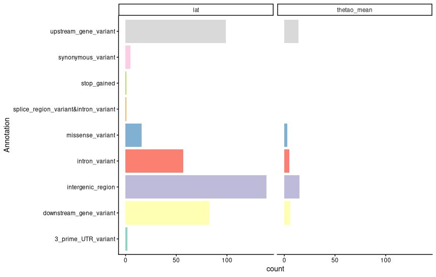

# Population Genomics notebook

**Course:** Intro to Ecological Genomics - Fall 2026

**Name:** Meron Abraham

**Date:** 11/3/2026

------------------------------------------------------------------------

## Gene Ontology

-   Looking at GO terms for significant genes
-   Review of Pop Gen topics

### Working directory

`/gpfs1/home/m/a/mabraha3/projects/eco_genomics_2026/population_genomics`

### Input files

`none`

### Output files

`/gpfs1/home/m/a/mabraha3/projects/eco_genomics_2026/population_genomics/notebook entries/pop_gen_notebook_11_3.md`

### Scripts

`/gpfs1/home/m/a/mabraha3/projects/eco_genomics_2026/population_genomics/my scripts/gene_ontology.R`

### Code

`data_dir=/users/m/a/mabraha3/projects/eco_genomics_2026/population_genomics/mydata VCF=Lottia_gigantea_flt3_sub0.01.vcf.gz`

### Programs/dependencies

`R version 4.5.1` `RStudio`

### Graphs/images

Biological processes - GO term association

Annotated genes count for each parameter

### Tables

| Col1 | Col2 | Col3 | Col4 | Col5 |
|------|------|------|------|------|
|      |      |      |      |      |
|      |      |      |      |      |
|      |      |      |      |      |

#### Notes/observations

Observations and interpretations go here

### Next steps
