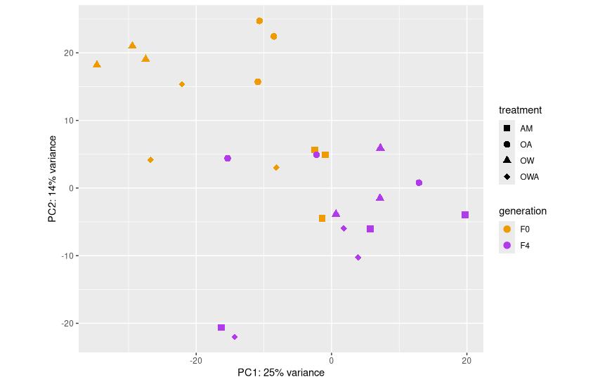
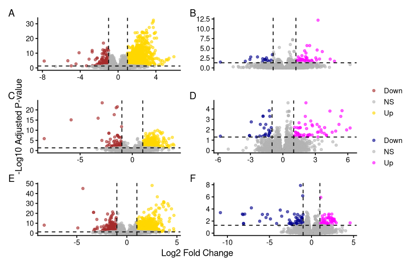

# Transcriptomics notebook

**Course:** Intro to Ecological Genomics - Fall 2026

**Name:** Meron Abraham

**Date:** 10/14/2026

------------------------------------------------------------------------

## Finishing HW1 script

-   Editing colors and shapes for readability and consistency
-   Tried changing filtering but decided against it

### Working directory

`/gpfs1/home/m/a/mabraha3/projects/eco_genomics_2026`

### Input files

`none`

### Output files

`/gpfs1/home/m/a/mabraha3/projects/eco_genomics_2026/transcriptomics/transcriptomics_notebook.md` `/gpfs1/home/m/a/mabraha3/projects/eco_genomics_2026/transcriptomics/homework 1/plots/DEG_volcano_plots.png` `/gpfs1/home/m/a/mabraha3/projects/eco_genomics_2026/transcriptomics/homework 1/plots/pca_all.png`

### Scripts

`none`

### Code

``` r
library(tidyverse)

print("Hello World")
```

### Programs/dependencies

`R version 4.5.1` `RStudio`

### Graphs/images

PCA showing each treatment and generation



Volcano plots showing upregulated and downregulated genes (left: F0, right: F4)



### Tables

| Col1 | Col2 | Col3 | Col4 | Col5 |
|------|------|------|------|------|
|      |      |      |      |      |
|      |      |      |      |      |
|      |      |      |      |      |

#### Notes/observations

F0 and F4 seem to form loose groups in the PCA

F0 shows a higher amount of upregulated genes across each treatment group compared to F4

### Next steps

Finish write-up!
